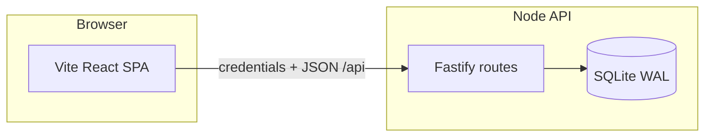

# Platform Ops Console

**Author:** Habib Noor (portfolio sample)  
**Purpose:** Demonstrate entry-level fullstack skills—React/TypeScript UI, a small reliable TypeScript API, filtering, auth, idempotent dead-letter replay, and audit logging—using **synthetic fixture data** only.

> **Disclaimers:** No affiliation with TikTok, Shopee, or any employer. Event names are illustrative of domains (live streaming, marketplace payments), not proprietary integrations. No production metrics or hiring claims.

## Quick start (local dev)

**Requirements:** Node.js 20+, npm, build tools for `better-sqlite3` (Python 3, make, g++).

```bash
npm ci
npm run dev
```

- Web UI: http://localhost:5173 (proxies `/api` to the API)
- API: http://localhost:3001

### Demo login (non-secret)

| Field    | Value                      |
|----------|----------------------------|
| Email    | `demo@platform-ops.local`  |
| Password | `demo-ops-console-2026`    |

Sessions are HTTP-only signed cookies. Passwords are not logged (Fastify log redaction).

### Other commands

```bash
npm test              # API + web Vitest suites
npm run typecheck     # TypeScript across packages
npm run lint          # ESLint (api + web)
npm run build         # shared → api → web
npm run db:seed       # reset SQLite file and re-seed fixtures
```

### Docker demo

```bash
docker compose up --build
```

Open http://localhost:3001 (API serves built UI when `SERVE_WEB=true`).

## Architecture



| Package | Role |
|---------|------|
| `packages/web` | Vite + React 19 + React Router; accessible tables/filters |
| `packages/api` | Fastify 5, Zod validation, cookie sessions, replay simulation |
| `packages/shared` | Shared TypeScript types + `SYNTHETIC_FIXTURE` provenance constant |

**Persistence:** SQLite file at `packages/api/data/ops-console.db` (created on first boot). Seeded automatically if empty. All rows include provenance `SYNTHETIC_FIXTURE`.

**Replay behavior:** `POST /api/dead-letters/:id/replay` requires `Idempotency-Key`. Updates delivery status to `pending` in SQLite, marks dead letter ineligible, appends audit row. **No outbound HTTP**—response includes `simulated: true`.

## Design decisions

1. **Monorepo workspaces** — One `npm ci` for interviewers; shared types prevent UI/API drift.
2. **Fastify over heavier frameworks** — Small surface area, built-in testing via `inject()`, explicit routes.
3. **SQLite** — Durable local persistence without cloud cost; WAL mode for modest concurrency.
4. **Cookie sessions** — Simpler than JWT in browser for a demo; still enforced on every protected handler via `preHandler`.
5. **Zod on inputs** — Bounded query params (`limit` ≤ 100) and login body size.
6. **Idempotency table** — Stores first replay result; duplicates return same payload with `duplicate: true` without double audit side effects (audit written once).
7. **Explicit synthetic banner** — UI banner + overview note + seed audit entry document data lineage.

## Known limitations

- Single-node SQLite; not HA or multi-tenant.
- Demo session secret defaults in code/README—not for production.
- No real webhook dispatcher, queue, or rate limiting.
- Docker image compiles native `better-sqlite3` module (requires build chain in image).
- Filtering is basic (`LIKE` search); no full-text index.

## AI assistance disclosure

This repository was developed with generic AI coding assistance for scaffolding, tests, and documentation. **Habib Noor has not necessarily reviewed every line**—treat this as a learning/portfolio artifact and verify claims in interviews.

## Interview prep

See [`artifacts/interview-notes.md`](artifacts/interview-notes.md) for module map, tradeoffs, failure experiments, and 30+ practice Q&A.

## License

MIT — see [LICENSE](LICENSE).
